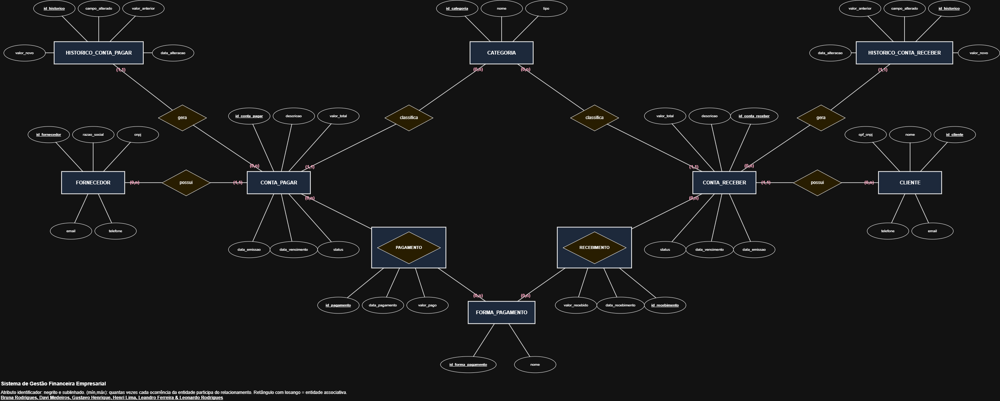

# projeto integrador de banco de dados do márcio uhulll - gestão financeira empresarial

|Arquivo|Conteúdo|Item da documentação|
|-|-|-|
|01\_criacao.sql|Banco, tabelas, PK, FK, NOT NULL, UNIQUE, CHECK|12|
|02\_insercao.sql|Dados fictícios|13|
|03\_manipulacao.sql|INSERT/SELECT/UPDATE/DELETE e riscos de exclusão|Etapa 7|
|04\_consultas.sql|13 consultas SQL|14|
|05\_views.sql|3 Views|15|
|06\_triggers.sql|6 Triggers|16|
|07\_testes.sql|Testes das Triggers e restrições|17|

## DER (MySQL Workbench)

## MER (Draw.io)

